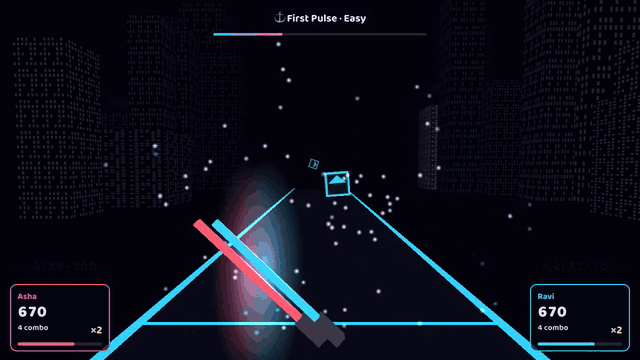
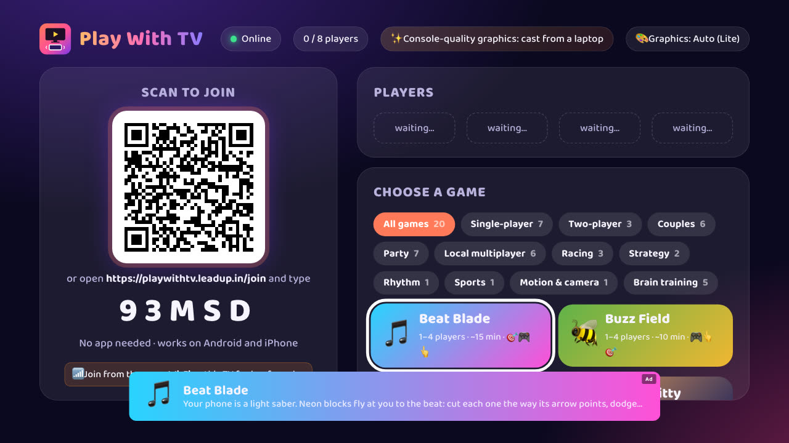
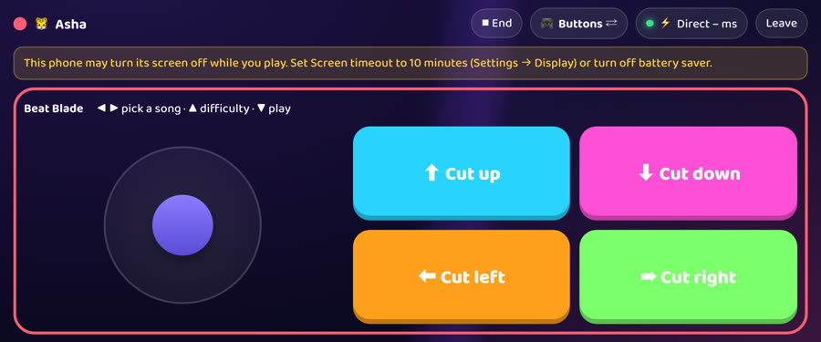
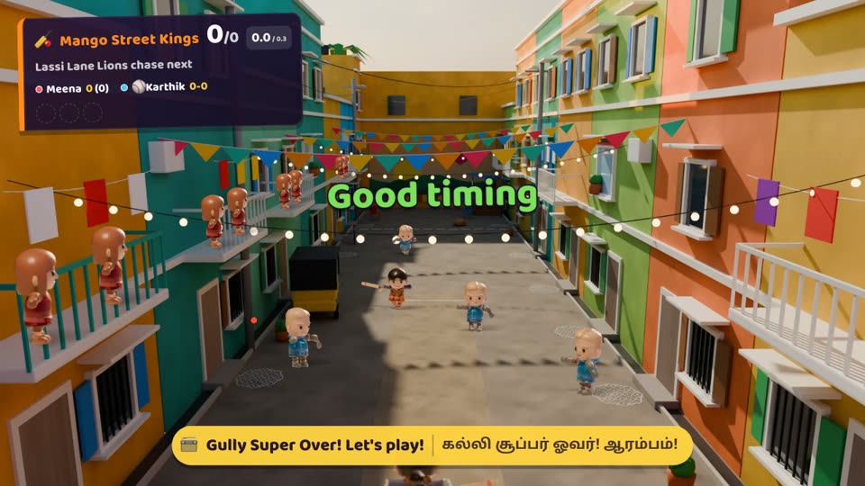
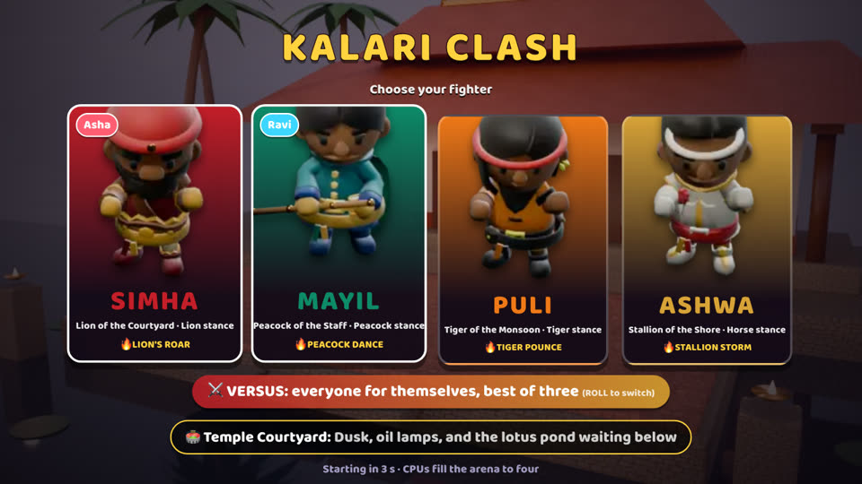
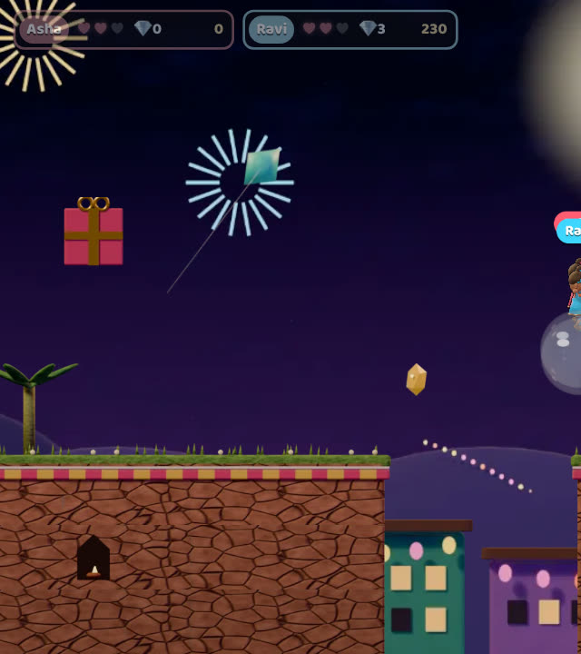
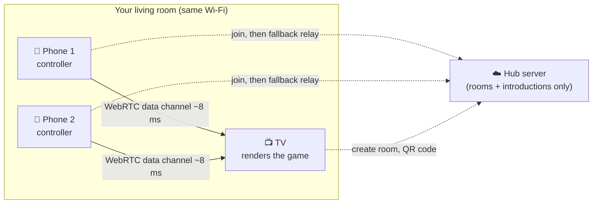
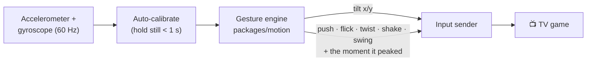
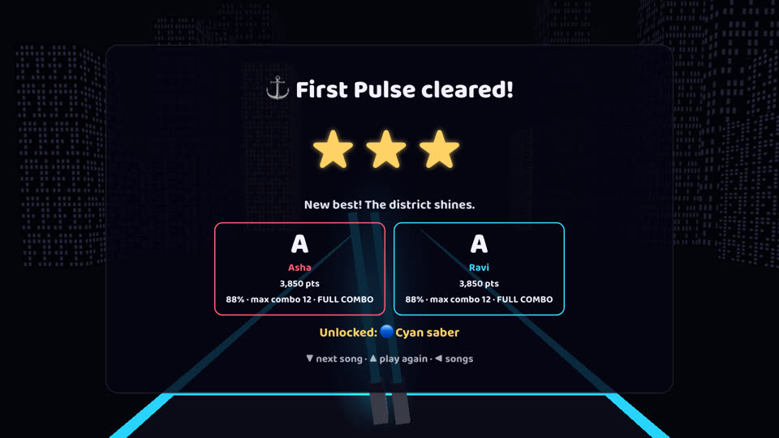

<div align="center">



# 📺 Play With TV

**Scan a QR code. Your phone becomes the controller. The TV becomes the console.**

Free, open-source party games for any smart TV or browser — no console, no app install, no account.
Up to 8 friends play together with the phones already in their pockets.

[**▶ Play now: playwithtv.leadup.in**](https://playwithtv.leadup.in) ·
[How it works](#-how-it-works) ·
[Run it yourself](#-run-it-yourself) ·
[Build a game](docs/building-games.md) ·
[Contribute](CONTRIBUTING.md)


</div>

---

## ✨ What it is

| | |
|---|---|
| 📱 **Phone = controller** | Buttons, a touchpad, or **motion**: tilt to steer, flick to slice, push to punch, swing to bat. Every player picks the mode they like. |
| 📺 **TV = console** | Any TV with a browser, the free Android TV app, a laptop on a projector. Games are drawn in 2D canvas or WebGL and tuned to run at 60 fps on 1 GB Android TVs. |
| ⚡ **Fast** | Phones talk to the TV over a direct WebRTC link on your Wi-Fi (about 8 ms). The server only introduces them and runs no game code. |
| 👨‍👩‍👧‍👦 **Everyone plays** | 1–8 players, no sign-up, nothing to install on the phones. |
| 🧩 **Built to grow** | Each game is one folder. Songs, dance routines, levels and trivia packs are plain text files anyone can write. |

<p align="center">
  <br>
  <sub>The TV lobby. Phones join by scanning the code.</sub>
</p>
<p align="center">
  <br>
  <sub>The phone controller: buttons, touchpad or motion, whichever each player picks.</sub>
</p>

## 🎮 The games

20 games are live today, and every one also plays with plain buttons.

| | Game | Players | What you do |
|---|---|:-:|---|
| 🎵 | **Beat Blade** | 1–4 | Your phone is a light saber: slice neon blocks to the beat of original synth songs |
| 🏏 | **Gully Super Over** | 1–8 | Street cricket: swing the phone to bat, flick to bowl |
| 🛺 | **Ghat Rush** | 1–8 | Split-screen monsoon racing down mountain hairpins |
| 🥋 | **Kalari Clash** | 1–4 | A martial-arts brawler: chain strikes, kicks and specials |
| 🏮 | **Lantern Lane** | 1–4 | A co-op platformer through a festival night |
| ☔ | **Monsoon Courier** | 1–4 | A speed platformer race over rain-soaked rooftops |
| 🗝️ | **Stepwell Secrets** | 1–4 | Climb, swing and solve your way down an ancient step-well |
| 🫓 | **Tiffin Tornado** | 1–4 | Co-op kitchen chaos on a moving train |
| 🍳 | **Kitchen Rush** | 2 | Run a food truck together |
| 🛋️ | **Carry Me Home** | 1–2 | Carry a sofa together through a house — in step |
| 🚲 | **Tandem Ride** | 1–2 | A bike that only flies when you pedal together |
| 🏗️ | **Skyline Stacker** | 1–4 | Falling-block city building |
| 🐛 | **Glowworm Grove** | 1–4 | A glowing snake game in night gardens |
| 🐱 | **Comet Kitty** | 1–4 | Maze chase in a space station |
| 🐝 | **Buzz Field** | 1–4 | Minesweeper in a meadow, with forgiving honey jars |
| ♟️ | **Kings Row** | 1–2 | Draughts / checkers, phone against phone or the AI |
| 🔴 | **Drop Four** | 1–2 | Four in a row at the travelling fair |

The couples games (Mind Match, Two Paths, Lantern Truths) and Tamil Trivia Royale are held back from TVs while they are reworked.
More are on the way: a **dance game** (Groove Party), motion sports (bowling, boxing, air hockey, penalties, kart racing)
and camera fitness games where the phone watches your body and **the video never leaves the phone**.
The full list with status is in [docs/catalogue.md](docs/catalogue.md).

<p align="center">
  
  
  
  <br><sub>Gully Super Over · Kalari Clash · Lantern Lane</sub>
</p>

## 🕹️ How to play

1. **On the TV** open [playwithtv.leadup.in/tv](https://playwithtv.leadup.in/tv) in its browser, or install the Android TV app (`apps/tv-android`).
2. **On each phone** scan the QR code on the TV (or type the 5-character room code at `/join`). Enter a name.
3. **Pick a game** on the TV. Each phone shows its controller; choose **Buttons**, **Touchpad** or **Motion**.
4. Every game starts with a short **practice** so everyone learns the moves before it counts.

> **Motion tips:** hold the phone the way the game shows (usually sideways). On iPhone, tap *Allow* when Safari asks
> for motion access. Open `/sensors` on a phone to check its sensors are working.

## 🧠 How it works



1. The **TV** asks the hub for a room and shows its QR code.
2. A **phone** scans it, joins the room over a WebSocket, and the hub introduces the phone to the TV (WebRTC signalling).
3. From then on the phone sends input **straight to the TV** over a WebRTC data channel. If the Wi-Fi blocks that,
   input goes through the hub instead, and the game keeps going.
4. The **game runs entirely on the TV**: physics, rules, music, drawing. The phone only sends small input messages,
   such as a stick position or "punch at 12:00:01.234".

**Why the server stays light:** it never runs games or streams video. A room costs a few kilobytes, and once the
direct link is up the input stays inside your home and never touches the server. Rooms, connections per address and
relay traffic are capped, so one small server can host many living rooms at once.

### Motion, done on the phone



- `packages/motion` turns raw sensor readings into **tilt** and **gestures** on the phone itself.
- Each gesture is stamped with the moment it **peaked**, so rhythm and sports games judge *your* timing, not the Wi-Fi's.
- The same game code works with buttons, touchpad or motion. A game only ever sees actions such as `"roll"` or `"jump"`.

### Repository map

```
apps/
  server/        Fastify hub: rooms, WebSocket signalling, relay fallback, admin API (Postgres/Redis optional)
  web/           React + Vite: the TV app (/tv), the phone controller (/join), every game in src/games/<game>/
  tv-android/    Tiny Android TV wrapper (WebView) with a TV launcher banner
packages/
  protocol/      Shared types, message schemas (zod) and the game catalogue
  motion/        The phone-side gesture engine (tilt, push, flicks, saber swings) with tests
content/         Trivia question packs (plain JSON)
tools/blender/   Blender scripts that render sprites, backdrops and 3D models (CC0)
e2e/             Playwright tests: a real TV page plus simulated phones with fake motion sensors
docs/            Building games, performance budgets, device compatibility, real-device test checklist
examples/        Self-hosting with Docker Compose + nginx
```

## 🚀 Run it yourself

### Requirements

- **Node.js 26+** and **pnpm 10** (`corepack enable` sets up pnpm)
- macOS, Linux or Windows (WSL)
- Optional: Docker (for self-hosting), Blender 4 (for art assets), Android Studio / Gradle (for the TV app)

### 1. Install and start

```bash
git clone https://github.com/leadupofficial/playwithtv.git
cd playwithtv
corepack enable
pnpm install
pnpm dev
```

Open **http://localhost:5173/tv** for the TV and **http://localhost:5173/join** in another tab as a phone.
Buttons and touchpad work right away. `?quick=1` on the TV URL makes every game short, which helps when testing.

### 2. Play with real phones on your Wi-Fi

Phones only allow motion sensors on **https** pages, so the dev server can serve a self-signed certificate:

```bash
sh scripts/start-lan.sh                # macOS: finds your Wi-Fi IP itself
IP=192.168.1.20 sh scripts/start-lan.sh  # Linux: give your computer's LAN IP
```

It prints the TV and phone addresses. Open the TV address on the TV (or laptop) and scan the QR code with your phones.
Accept the certificate warning once on each device. Logs are in `.run/`.

### 3. Check your changes

```bash
pnpm typecheck     # TypeScript across every package
pnpm test          # unit tests (Vitest)
pnpm e2e           # end-to-end: real TV page + simulated phones (Playwright; first: pnpm exec playwright install chromium)
pnpm perf          # frame-time budget per game against the production build, on a software GPU
pnpm build         # production build
```

### 4. Self-host with Docker

```bash
cd examples/self-host
cp ../../.env.example .env        # set ADMIN_TOKEN, add POSTGRES_PASSWORD=… (openssl rand -hex 24 for each)
# replace play.example.com in docker-compose.yml and nginx.conf with your domain
docker compose up -d --build
```

The hub listens on `127.0.0.1:8080`. Put nginx, Caddy or Traefik with TLS in front of it ([nginx.conf](examples/self-host/nginx.conf)).
Without `DATABASE_URL` and `REDIS_URL` it runs in memory, which is fine for a single box. Settings are in [.env.example](.env.example).
In production the server **refuses to start** with a weak `ADMIN_TOKEN`, an empty `ALLOWED_ORIGINS` or a non-https `PUBLIC_URL`.

### 5. The Android TV app (optional)

```bash
cd apps/tv-android
gradle assembleDebug                # Gradle 8, or open the folder in Android Studio
adb connect <tv-ip>:5555 && adb install -r app/build/outputs/apk/debug/app-debug.apk
```

It opens the TV page full screen, keeps the screen on, and retries on its own if the TV's network or DNS hiccups.

## 🎨 Graphics, animation and sound

- **2D games** draw on a `<canvas>` at 1280×720 and scale to the TV. **3D games** use three.js with a *lite* mode for weak TVs.
- **Quality tiers** (`lite` / `high` / `ultra`) are picked from the TV's GPU and memory, and adjust if frames drop. Glow, shadows and particles
  scale down on 1 GB TVs, so frame time stays inside the budget in [docs/performance.md](docs/performance.md).
- **Art** is drawn in code or rendered from **Blender** scripts in `tools/blender/` (`pnpm assets:sprites`, `pnpm assets:glb`).
  Everything is original or CC0; third-party assets are listed in [ASSETS.md](ASSETS.md).
- **Music** is composed as patterns and played by a small in-browser **synthesiser** (`games/beat-blade/music.ts`).
  There are no recordings, so no copyright problems, and a whole song costs a few hundred bytes.
<p align="center"></p>

- **Animation** runs on `requestAnimationFrame` with fixed-step physics (1/60 s), so a game behaves the same on a
  30 fps TV and a 120 fps laptop.

## 🤝 Contributing

We want **100+ games** made by the community, and you don't have to be a programmer to help:

| You can… | Start here |
|---|---|
| 🎵 Write a song or a dance routine (plain text) | `apps/web/src/games/beat-blade/songs.ts`, `games/groove/songs.ts` |
| ❓ Write a trivia pack (JSON) | `content/trivia/` + `pnpm content:check` |
| 🎮 Build a whole game | [docs/building-games.md](docs/building-games.md) |
| 📱 Test on your phone or TV | [docs/real-device-test.md](docs/real-device-test.md), then add a row to [docs/compatibility.md](docs/compatibility.md) |
| 🐛 Report a bug or idea | [Open an issue](https://github.com/leadupofficial/playwithtv/issues/new/choose) |

Read [CONTRIBUTING.md](CONTRIBUTING.md) first. Every pull request runs typecheck, unit tests, e2e and the
weak-TV performance gate, so a new game can't slow down the others.

## 👥 Core contributors

<table>
  <tr>
    <td align="center">
      <a href="https://github.com/leadupofficial"><br><b>Abishek Sivakumar</b></a><br>
      <sub>Creator · maintainer</sub>
    </td>
    <td align="center">
      <a href="https://github.com/pradeeplogu0"><br><b>Pradeep</b> (@pradeeplogu0)</a><br>
      <sub>Core contributor · embedded & sensors</sub>
    </td>
  </tr>
</table>

Thanks to everyone who has played, tested on their TV, or sent a song. See all [contributors](https://github.com/leadupofficial/playwithtv/graphs/contributors).

## 🔒 Security and privacy

- No accounts, emails or phone numbers. The only thing a player gives is a display name, kept with match history.
- Camera games process video **on the phone**; frames are never uploaded.
- Report vulnerabilities privately; see [SECURITY.md](SECURITY.md).

## 📄 Licence

Code: [MIT](LICENSE) © Leadup Technologies and the Play With TV contributors.
Trivia content, fonts and other assets keep their own licences (CC BY 4.0, CC0, SIL OFL), listed in [ASSETS.md](ASSETS.md).

<div align="center"><sub>Made in India for living rooms everywhere 📺📱</sub></div>
